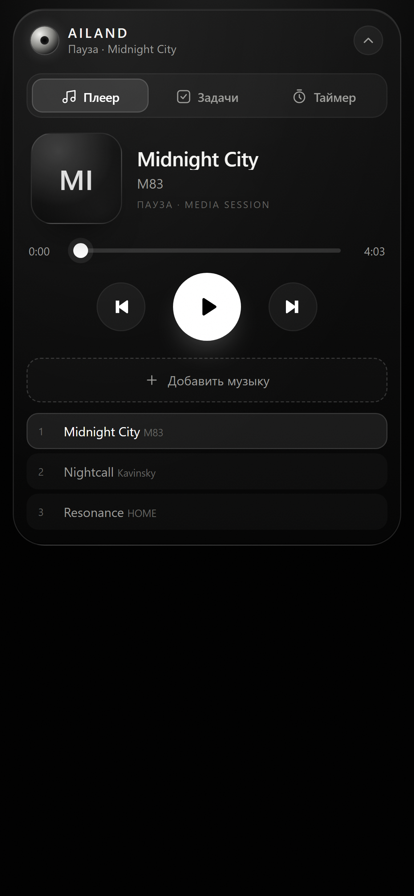
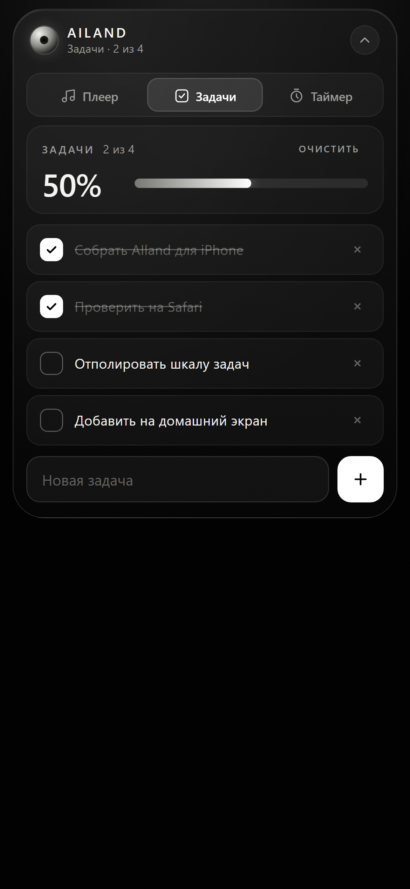
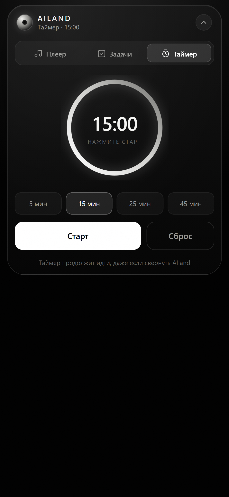

# AIland для iPhone

Мобильная версия AIland — PWA (веб-приложение), которое ставится на экран «Домой» в iPhone и выглядит как Dynamic Island: плеер, задачи со шкалой выполнения и таймер в одном чёрно-белом стеклянном острове.

## Почему не .ipa

Собрать `.ipa` без macOS, Xcode и подписи Apple невозможно, а главное — iOS не разрешает сторонним приложениям рисовать оверлей поверх других приложений. Область «острова» в системном смысле доступна только Live Activities самого приложения. Поэтому AIland для iPhone сделан как PWA: он открывается с домашнего экрана на весь экран, без адресной строки Safari, и работает офлайн.

## Что умеет

- **Плеер** — выбор локальных аудиофайлов из «Файлов»/iCloud, обложка-монограмма, перемотка, предыдущий/следующий, интеграция с Media Session (обложка и название в экране блокировки, кнопки на наушниках).
- **Задачи** — добавление, отметка выполнения, удаление, очистка выполненных, крупная шкала прогресса. Хранится в `localStorage`, не пропадает после перезапуска.
- **Таймер** — пресеты 5/15/25/45 минут, кольцо прогресса, пауза/продолжение, звуковой сигнал и вибрация. Таймер продолжает идти, даже если свернуть AIland (время считается по `Date.now()`), и восстанавливается после перезагрузки.
- Остров сворачивается в пилюлю и разворачивается тапом, высота панели подстраивается под содержимое вкладки.

## Скриншоты

| Плеер | Задачи | Таймер |
| --- | --- | --- |
|  |  |  |

## Локальный запуск

Любой статический сервер из папки `AIland-mobile`, например:

```bash
npx serve AIland-mobile
# или
python -m http.server 8123 --directory AIland-mobile
```

Демо с заполненными данными: `http://localhost:8123/?demo`. Параметры: `?demo` — пример задач и треков, `?open` — сразу развернуть остров, `?view=tasks|timer|player` — открыть на вкладке.

## Установка на iPhone

1. Выложите папку на любой HTTPS-хостинг (GitHub Pages, Netlify, Cloudflare Pages, свой сервер). Service worker и установка требуют HTTPS.
2. Откройте адрес в **Safari** на iPhone.
3. Кнопка «Поделиться» → **«На экран „Домой“»**.
4. Запустите AIland с домашнего экрана — откроется на весь экран без Safari.

## Как выложить на GitHub Pages

```bash
git subtree push --prefix AIland-mobile origin gh-pages
```

Затем в настройках репозитория: **Settings → Pages → Source: ветка `gh-pages`, папка `/`**. Адрес будет вида `https://sagarmzk.github.io/AI-land/`.

## Ограничения

- Плейлист живёт в памяти вкладки: после перезапуска приложения файлы нужно выбрать заново (iOS не даёт веб-приложению постоянный доступ к файлам).
- Системные уведомления о конце таймера приходят, только если разрешены и приложение не выгружено из памяти; звук срабатывает при открытом AIland.
- Оверлея поверх других приложений нет — это ограничение iOS, а не реализации.

## Файлы

- `index.html` — разметка острова и вкладок
- `styles.css` — тема, анимации, адаптивная высота
- `app.js` — логика плеера, задач и таймера
- `manifest.webmanifest`, `sw.js`, `icons/` — установка и офлайн-кэш
